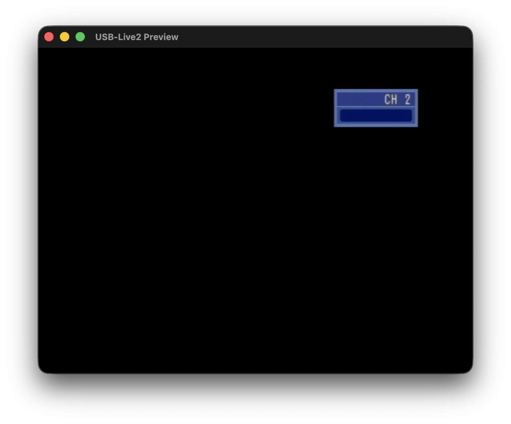
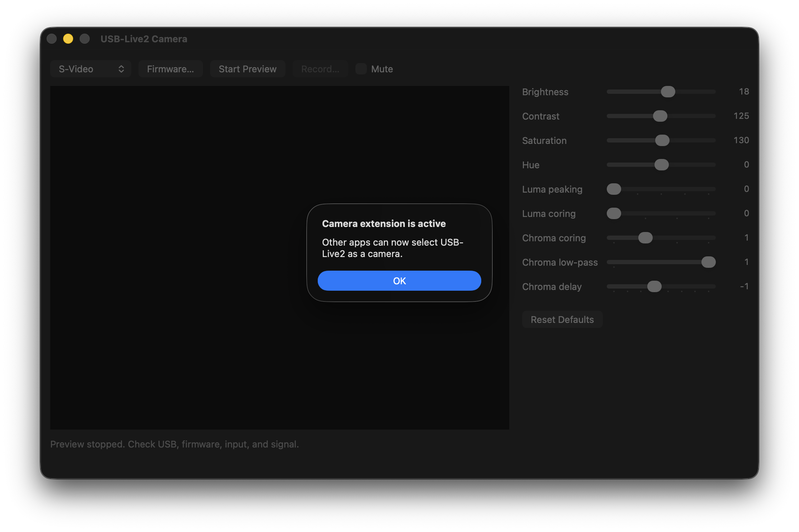
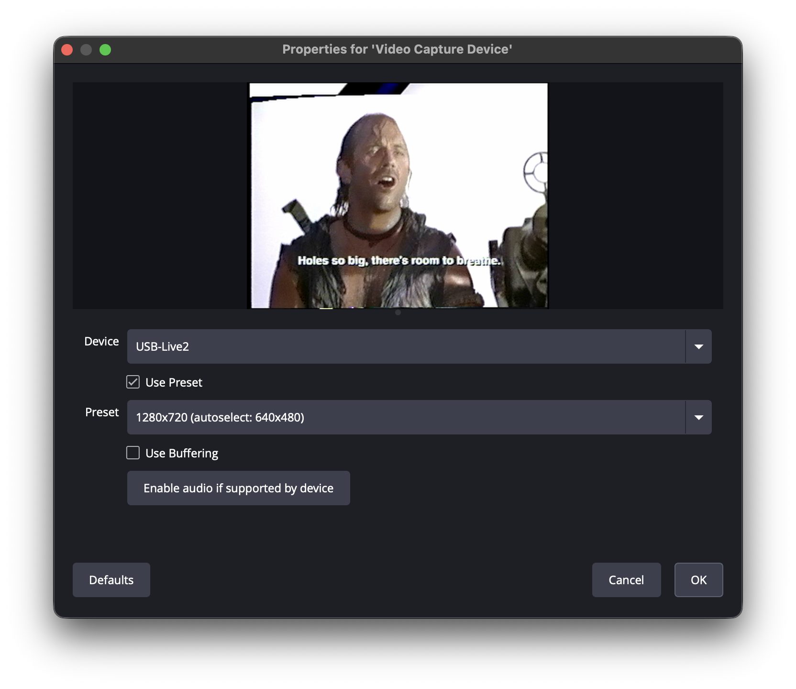
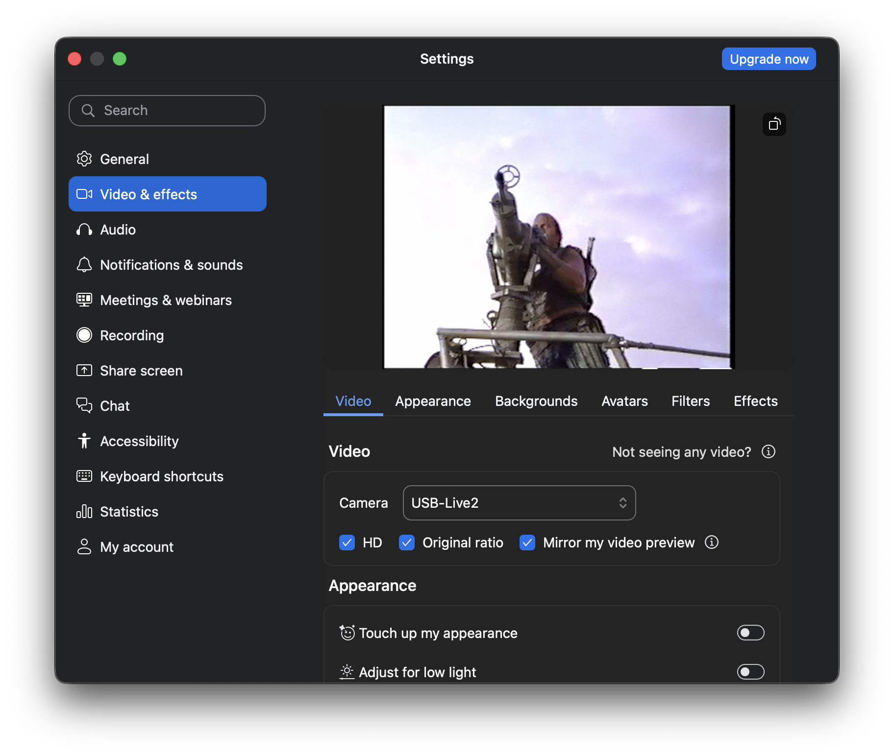

# USB-Live2 Capture for macOS

Capture NTSC-M from a Hauppauge USB-Live2 on macOS. The default recording is 720×480 interlaced FFV1 (lossless compression) v3 video with 48 kHz stereo PCM in a Matroska file. Connect composite or S-Video and the separate left and right line-audio leads to the digitizer.

## CLI & Firmware

When initializing or capturing, the command line interface (CLI) loads the bundled Linux firmware from `firmware/` next to the executable. Keep that folder with the binary. Run `./usblive2-probe --help` for commands and `./usblive2-probe --picture-help` for picture controls.

Use `--firmware PATH` before `--init` or a capture command to select a compatible 16,382-byte decoder image. The former positional firmware argument still works. The [firmware notes](firmware/README.md) document the Linux image and two local Windows driver images. The source archive and both app builds include the Linux image under the [Conexant license](firmware/LICENSE.conexant).

```sh
./usblive2-probe --init
./usblive2-probe --stream svideo 5
```

## Record & Verify

Start playback on the NTSC source before recording. Give each recording a new output directory. The first command below lists matching USB devices.

```sh
./usblive2-probe
caffeinate -i ./usblive2-probe --record svideo ./recording
python3 scripts/verify-mkv.py ./recording
```

Use `composite` for the composite input. To record for a fixed time, put the duration in seconds before the output directory, for example `--record svideo 60 ./recording`. For an untimed capture, press Ctrl-C to stop. Verification requires Python 3.10+ and FFmpeg on your PATH.

A successful timed FFV1 capture saves `capture.mkv` and `capture.json`. Interrupted captures return a nonzero status and keep any recoverable media as `capture.partial.mkv`. The report gives the stop reason and indicates whether the file finalized. For finalized FFV1 captures with both tracks, the verifier compares decoded bytes with the recorded hashes. You can also check whether both tracks in a partial capture decode.

```sh
ffmpeg -v error -xerror -err_detect crccheck+explode -i ./recording/capture.partial.mkv -map 0:v -map 0:a -fps_mode passthrough -f null -
```

## Live Preview

Add `--preview` before `--record` to open a silent, deinterlaced preview. This requires `ffplay` on your PATH. Closing the window leaves recording running.

```sh
caffeinate -i ./usblive2-probe --preview --record svideo ./recording
```

Use `--preview --view` instead to watch without saving a file. The view-only session stops when its last viewer closes or you press Ctrl-C.



## Picture Controls

Use `--picture NAME=VALUE` before a capture mode to apply a decoder setting at startup. Repeat the option to set several controls. Use `--picture-help` for the accepted ranges and defaults in decoder steps. Peaking `0` bypasses the filter and `1`-`4` select increasingly strong settings. Hue and brightness use signed steps. A saturation setting adjusts both chroma channels together. Coring suppresses small level changes, and the chroma low-pass filter softens high-frequency color detail.

```sh
./usblive2-probe --picture-help
./usblive2-probe --picture peaking=4 --picture brightness=18 --record svideo ./adjusted-recording
caffeinate -i ./usblive2-probe --preview --live-controls --view svideo
```

During live preview, enter `brightness=25`, `peaking=4`, or another `NAME=VALUE` in Terminal and press Return. Enter `help` to see the ranges, or `reset` to restore every picture control. Bare digits `0`-`4` and the `--live-peaking` flag still work. Picture changes affect the incoming video before encoding. The capture restores the decoder defaults when it stops.

## Recording from the macOS App

Open **USB-Live2 Camera** from Applications. Select **S-Video** or **Composite**, click **Start Preview**, then click **Record…** and choose a destination folder. **Stop Recording** saves the clip and leaves the preview running.

The app creates a timestamped folder containing `capture.mkv` and a capture report. It records interlaced FFV1 video and 48 kHz stereo PCM. Use **Firmware…** to select a different decoder image. Picture controls apply during preview and are locked while recording. **Mute** affects playback only. A capture interrupted by a fault keeps any recoverable media as `capture.partial.mkv`.

For a local build of the same capture window, run:

```sh
make monitor
open "dist/USB-Live2 Monitor.app"
```

The local Monitor build uses the build machine's FFmpeg libraries. The Camera app bundles its recording libraries.

## Optional macOS Camera Extension

Open the notarized app from Applications and choose **USB-Live2 Camera → Install Camera Extension…**. If macOS prompts for approval, enable it under **System Settings → General → Login Items & Extensions → Camera Extensions**.



Select **USB-Live2** as a **Video Capture Device** in OBS or as the camera in Zoom's **Video & effects** settings. For direct camera capture, stop the USB-Live2 app's preview or recording first so the extension can open the device. The extension releases the device when the last camera client stops. It uses its bundled firmware, tries S-Video first, and falls back to composite if S-Video has no NTSC lock. Each field becomes one progressive 640×480 frame at 59.94 fps. Choose a separate audio input.





The CLI can also publish video through the installed extension while recording with `--camera --record`.

### Building & Notarizing the Camera App

`make camera` builds the capture app, extension, and CLI publisher with the macOS Command Line Tools, libusb, and FFmpeg. The capture app requires macOS 14 or the bundled libraries' minimum version, whichever is newer.

Without signing inputs, the build produces `dist/USB-Live2 Camera (unsigned).app` for inspection. Supply `SIGN_IDENTITY`, `TEAM_ID`, `HOST_PROFILE`, and `EXTENSION_PROFILE` for a Developer ID build. Set `CAMERA_BUILD_VERSION` higher than the installed version when building an update.

macOS checks notarization when you activate a Developer ID system extension, even for a local build. After Apple accepts each rebuild, staple the ticket and check Gatekeeper before copying the app to `/Applications`. Replace `PROFILE` with the name of your [saved notarization credentials](https://developer.apple.com/documentation/security/customizing-the-notarization-workflow). If you saved the profile to a specific keychain, also pass `--keychain PATH` to `notarytool`.

```sh
app="dist/USB-Live2 Camera.app"
ditto -c -k --keepParent "$app" "dist/USB-Live2 Camera.zip"
xcrun notarytool submit "dist/USB-Live2 Camera.zip" --keychain-profile PROFILE --wait
# Continue after notarytool reports Accepted.
xcrun stapler staple "$app"
xcrun stapler validate "$app"
spctl --assess --type execute --verbose "$app"
```

## Direct Recording Codecs

Put `--codec` before `--record` to choose the format written from the live capture queue.

```sh
./usblive2-probe --codec prores --record svideo ./edit
./usblive2-probe --codec h264 --record svideo ./viewing
```

| Profile | Output | Video | Audio |
| --- | --- | --- | --- |
| `ffv1` (default) | `capture.mkv` | Lossless 8-bit 4:2:2, both fields woven | Original PCM |
| `prores`  | `capture.mov` | ProRes 422 HQ, both fields woven | Original PCM |
| `h264`    | `capture.mp4` | Software H.264, 4:2:0, one progressive frame per field | Stereo AAC |
| `h264-hw` | `capture.mp4` | VideoToolbox H.264, same picture format, 4 Mb/s target | Stereo AAC |
| `raw`     | `capture.mov` | Uncompressed packed YUYV 4:2:2, both fields woven | Original PCM |

All profiles use the same bounded acquisition queues. MOV and MP4 are fragmented so completed fragments can be read before capture ends and retained after a failed append. Data still buffered in the encoder or current fragment may be lost on a disk error. The hardware profile requires a working VideoToolbox encoder. AAC uses a continuous 48 kHz sample clock anchored at the start of audio and includes codec priming.

`scripts/verify-mkv.py` checks both sample hashes for FFV1 and raw. For ProRes it checks that both tracks decode and that the PCM matches its hash. For either H.264 profile it checks that both tracks decode.

You can also make ProRes and H.264 copies from a completed FFV1 capture. For a Ctrl-C recording, substitute `capture.partial.mkv` if the report says it finalized.

```sh
# Edit copy with interlaced ProRes 422 HQ and the original PCM
ffmpeg -n -i recording/capture.mkv -map 0:v:0 -map 0:a:0 \
  -c:v prores_ks -profile:v hq -pix_fmt yuv422p10le \
  -flags +ildct -field_order tt -c:a copy edit.mov

# Viewing copy with one progressive frame per field
ffmpeg -n -i recording/capture.mkv -map 0:v:0 -map 0:a:0 \
  -vf 'bwdif=mode=send_field:parity=tff:deint=all' \
  -c:v libx264 -preset fast -crf 18 -pix_fmt yuv420p \
  -c:a aac -b:a 192k -movflags +faststart view.mp4
```

## Verification & Export Scripts

- [`scripts/verify-mkv.py`](scripts/verify-mkv.py) verifies a capture directory and its JSON report.
- [`scripts/export-vhs-hd.sh`](scripts/export-vhs-hd.sh) makes a 59.94 fps ProRes copy of a top-field-first 720×480 capture and copies the audio. It requires `ffmpeg`, `ffprobe`, VapourSynth's `vspipe`, FFMS2, and a working QTGMC installation. Its [VapourSynth script](scripts/vhs-qtgmc.vpy) uses `znedi3` or `nnedi3` to double both dimensions by default. Run `NO_SCALE=1 scripts/export-vhs-hd.sh recording/capture.mkv edit.mov` to keep the original dimensions, or use `--help` for options.

## Building

Install the Xcode Command Line Tools and the required Homebrew dependencies, then run the build and checks from this directory. The checks also require Python 3.10 or later.

```sh
xcode-select --install
brew install libusb pkgconf ffmpeg
make check
```

The build and checks have passed with Homebrew libusb 1.0.30 and FFmpeg 9.0.2. For libraries installed outside Homebrew, set `PKG_CONFIG_PATH` to the directory containing their `.pc` files. If the dylibs use `@rpath`, pass `LDFLAGS=-Wl,-rpath,/path/to/lib` to `make` as well.

The CLI, shared capture code, Monitor, and camera extension live under [`src/`](src/). Tests live in [`tests/`](tests/) and recording tools in [`scripts/`](scripts/). `make dist` packages the source, documentation, and Linux firmware in `dist/usblive2-macos-source.tar.gz`. The screenshots are available in the repository. By default, `make` and `make monitor` ad hoc sign the CLI and Monitor for local use.

All C and Objective-C builds share warnings for format strings, conversions, shadowing, prototypes, undefined preprocessor symbols, variable-length arrays, and implicit fallthrough. Third-party headers are treated as system headers. Run `make -B check monitor CFLAGS='-O2 -Werror'` for a strict rebuild; the camera helper and Swift builds also reject warnings. Tests keep assertions enabled even when `CFLAGS` defines `NDEBUG`.

## Tested Setup

| Component | Tested configuration |
| --- | --- |
| Mac | MacBook Pro `MacBookPro18,2` (M1 Max, arm64), macOS 26.7.3 build `25G342` |
| Digitizer | USB-Live2 `2040:c200`, USB device revision `0x4001`, 480 Mb/s, no hub visible to macOS |
| Input | NTSC-M S-Video picture and stereo PCM. Composite USB transport and absent-signal reporting were tested. |
| Storage | Local storage for normal recording, a small mounted HFS+ image for disk-full recovery |

## Troubleshooting

- **Device missing or interfaces busy.** Quit other capture software and try a direct USB connection. Run `./usblive2-probe --claim` to check access. A restricted process may see an empty device list even when Terminal can claim the device.
- **Firmware missing or initialization failed.** Keep `firmware/` next to the CLI, or pass a path with `--firmware`. Power-cycle the USB-Live2 before retrying a failed initialization.
- **Camera extension reports “code signature invalid.”** Run `spctl --assess --type execute --verbose "/Applications/USB-Live2 Camera.app"`. If it reports `Unnotarized Developer ID`, notarize and staple that build before retrying activation.
- `no_video_lock` **or** `video_lock_lost`**.** Check that the video lead matches the selected input and the source is playing NTSC-M. The recorder checks decoder H/V lock before capture and periodically during capture.
- `queue_full` **or** `disk_full`**.** Check free space and storage speed. FFV1 size and encoding load vary with the source. The report shows how full the queues got.
- **Duration looks wrong in a player.** The growing Matroska format omits a fixed duration and seek index. Consult the report or packet timestamps for elapsed time.

The CLI source is licensed GPL-2.0-or-later. [License](COPYING)
